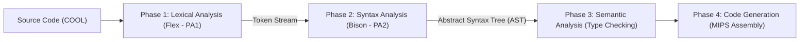

# Comprehensive Compiler Study Guide & Discussion Prep
## CS143 COOL Compiler — Programming Assignment 1 (PA1) & Programming Assignment 2 (PA2)

> **دليل المذاكرة والاستعداد لمناقشة مشروع المترجمات (Compiler Project Oral Exam & Defense Guide)**
> هذا الدليل مُعد خصيصاً لمساعدتك على فهم كل تفاصيل المشروع والإجابة على أي سؤال يطرحه عليك الدكتور أو المعيد في المناقشة.

---

## 📑 فهرس المحتويات (Table of Contents)
1. **نظرة عامة على مراحل المترجم ودور المشروع (Compiler Architecture Overview)**
2. **التكليف الأول PA1: التحليل اللغوي (Lexical Analysis - Flex)**
   - المطلوب في التكليف (Requirements)
   - شرح كود `cool.flex` بالتفصيل وقاعدة بقاعدة
   - كيفية معالجة الحالات الحرجة (التعليقات المتداخلة، النصوص، أخطاء Null)
   - شرح ملف الاختبار `test.cl`
3. **التكليف الثاني PA2: التحليل النحوي وبناء شجرة الإعراب (Syntax Analysis & AST - Bison)**
   - المطلوب في التكليف (Requirements)
   - شرح كود `cool.y` وبنية القواعد (Grammar Rules)
   - حل مشكلة غموض الـ Let (Let-In Ambiguity & `%prec LETPREC`)
   - آليات التعافي من الأخطاء النحوية الأربعة (Error Recovery)
   - شرح ملفات الاختبار `good.cl` و `bad.cl`
4. **أهم الأسئلة الشفوية المتوقعة في المناقشة مع إجاباتها النموذجية (Expected Interview Q&A)**
5. **جدول ملخص لأهم المصطلحات التقنية (Key Terms & Definitions)**

---

# 1. نظرة عامة على مراحل المترجم (Compiler Architecture Overview)

المترجم (Compiler) هو برنامج يقوم بتحويل الكود المكتوب بلغة عالية المستوى (Source Code) إلى كود يفهمه الحاسوب (مثل لغة الآلة أو Assembly). تتكون هذه العملية من عدة مراحل متتابعة:



### أين يقع مشروعنا في هذه المراحل؟
* **PA1 (الـ Scanner / Lexer)**: يأخذ النص كحروف عادية (`char stream`) ويجمعه في وحدات ذات معنى تُسمى **Tokens** (مثل الكلمات المفتاحية، أسماء المتغيرات، الأرقام، العمليات).
* **PA2 (الـ Parser)**: يأخذ سيل الـ Tokens من الـ Lexer ويتأكد أنها مكتوبة وفق قواعد اللغة (Context-Free Grammar). وخلال هذه العملية يقوم ببناء **شجرة الإعراب المجردة (Abstract Syntax Tree - AST)** التي تُمثل البنية الهرمية للبرنامج.

---

# 2. التكليف الأول: التحليل اللغوي (PA1 — Lexical Analysis)

### 🎯 ما الذي طلبه التكليف في PA1؟
1. كتابة مواصفات الـ Lexer للغة COOL داخل ملف `cool.flex`.
2. التعرف على كافة الكلمات المفتاحية (`class`, `if`, `then`, `else`, `while`, `loop`, `let`, إلخ) بصورة غير حساسة للأحرف (**Case-Insensitive**).
3. التمييز بين أسماء الأنواع (`TYPEID` تبدأ بحرف كبير) وأسماء الكائنات/المتغيرات (`OBJECTID` تبدأ بحرف صغير).
4. التعامل مع القيم المنطقية (`true` و `false` تبدأ بحرف صغير إجباري).
5. معالجة النصوص (String Constants) والتعامل مع حالات الهروب (`\n`, `\t`, `\0`, `\"`, إلخ) والأخطاء:
   - النص الطويل جداً (> 1024 حرفاً) يُرجع `"String constant too long"`.
   - النص المحتوي على حرف Null يُرجع `"String contains null character"`.
   - النص غير المغلق بسطر جديد يُرجع `"Unterminated string constant"`.
   - انتهاء الملف داخل النص يُرجع `"EOF in string constant"`.
6. معالجة التعليقات: أحادية السطر (`--`) ومتعددة الأسطر المتداخلة (`(* ... *)`).
7. تتبع رقم السطر بدقة في المتغير `curr_lineno`.

---

### 🔍 شرح كود `cool.flex` بالتفصيل

#### أ. قسم التعريفات وحالات البداية (Start Conditions)
```flex
%x COMMENT
%x STRING
%x STRING_ERROR
```
* **سؤال مناقشة مهم**: لماذا استخدمنا `%x` (Exclusive start conditions) بدلاً من `%s`؟
  * **الإجابة**: لأن الحالات الحصرية (`%x`) تعني أنه عند تفعيل حالة مثل `<COMMENT>` أو `<STRING>`، **فقط** القواعد التي تبدأ بـ `<COMMENT>` هي التي يتم فحصها، ويتم تجاهل باقي قواعد الكود تماماً، مما يمنع تداخل الكلمات المفتاحية أو الرموز أثناء قراءة نص أو تعليق.

---

#### ب. معالجة التعليقات المتداخلة (Nested Comments)
```flex
"(*"                    { comment_depth = 1; BEGIN(COMMENT); }
"*)"                    { cool_yylval.error_msg = "Unmatched *)"; return (ERROR); }

<COMMENT>"(*"           { comment_depth++; }
<COMMENT>"*)"           {
                            comment_depth--;
                            if (comment_depth == 0) { BEGIN(INITIAL); }
                        }
<COMMENT>\n             { curr_lineno++; }
<COMMENT>.              { /* ignore */ }
<COMMENT><<EOF>>        {
                            cool_yylval.error_msg = "EOF in comment";
                            BEGIN(INITIAL);
                            return (ERROR);
                        }
```
* **كيف يعمل؟**
  1. عند رؤية `(*` في البداية: نضبط العداد `comment_depth = 1` وننتقل إلى حالة `COMMENT`.
  2. إذا وجدنا `(*` أخرى داخل التعليق: نزيد العداد `comment_depth++` (تعليق متداخل).
  3. عند رؤية `*)`: ننقص العداد `comment_depth--`. وإذا وصل إلى الصفر، نعود للحالة الطبيعية `INITIAL`.
  4. إذا وصل الملف إلى نهايته `<<EOF>>` وما زال العداد > 0: نطلق الخطأ `"EOF in comment"`.
  5. إذا رأينا `*)` في الحالة الطبيعية دون فتح مسبق: نطلق الخطأ `"Unmatched *)"`.
* **سؤال مناقشة**: هل تستطيع التعبيرات النمطية (Regular Expressions) وحدها التعامل مع التعليقات المتداخلة بأي عمق؟
  * **الإجابة**: **لا!** لأن اللغات المنتظمة (Regular Languages) لا تمتلك ذاكرة (Memory/Stack) لعد الأقواس المتداخلة. لذلك احتجنا إلى استخدام متغير إضافي في لغة C وهو `comment_depth` لمتابعة عمق التداخل.

---

#### ج. معالجة النصوص وحالات الأخطاء (Strings)
تبدأ قراءة النص عند رؤية علامة الاقتباس `\"`:
```flex
\"                      { string_buf_ptr = string_buf; BEGIN(STRING); }
```
وداخل الحالة `<STRING>`:
1. **نهاية النص السليمة**:
   ```flex
   <STRING>\" {
       BEGIN(INITIAL);
       *string_buf_ptr = '\0';
       cool_yylval.symbol = stringtable.add_string(string_buf);
       return (STR_CONST);
   }
   ```
2. **السطر الجديد غير المهروب (خطأ)**:
   ```flex
   <STRING>\n {
       curr_lineno++;
       cool_yylval.error_msg = "Unterminated string constant";
       BEGIN(INITIAL);
       return (ERROR);
   }
   ```
3. **حرف الـ Null الحقيقي (خطأ)**:
   ```flex
   <STRING>\0 {
       cool_yylval.error_msg = "String contains null character";
       BEGIN(STRING_ERROR);
       return (ERROR);
   }
   ```
4. **تسلسل `\0` المهروب (مسموح به وفق دليل Cool)**:
   ```flex
   <STRING>\\0 {
       // يتم تحويله إلى الرمز '0' (ASCII 48)
       *string_buf_ptr++ = '0';
   }
   ```
5. **تجاوز الحد الأقصى (1024 حرفاً)**:
   في كل مرة نضيف حرفاً، نتأكد أن:
   ```c
   if (string_buf_ptr - string_buf >= MAX_STR_CONST - 1) {
       cool_yylval.error_msg = "String constant too long";
       BEGIN(STRING_ERROR);
       return (ERROR);
   }
   ```
6. **حالة استئناف الخطأ (`STRING_ERROR`)**:
   تستهلك ما تبقى من النص الخاطئ حتى تصل إلى `\"` أو `\n`، لتعود بعدها إلى `INITIAL`، مما يمنع حدوث انهيار في تحليل باقي الملف.

---

#### د. الكلمات المفتاحية والقيم المنطقية
* **الكلمات المفتاحية**: تم كتابتها بصيغة تتقبل أي حالة أحرف:
  ```flex
  [cC][lL][aA][sS][sS]     { return (CLASS); }
  [iI][fF]                 { return (IF); }
  ```
* **القيم المنطقية**: تنص مواصفات Cool على أنها **يجب** أن تبدأ بحرف صغير:
  ```flex
  t[rR][uU][eE]    { cool_yylval.boolean = 1; return (BOOL_CONST); }
  f[aA][lL][sS][eE] { cool_yylval.boolean = 0; return (BOOL_CONST); }
  ```
  أما إذا بدأت بحرف كبير مثل `True`، فإن قاعدة `TYPEID` تلتقطها لأنها تبدأ بـ `[A-Z]`.

---

# 3. التكليف الثاني: التحليل النحوي وبناء الـ AST (PA2 — Parsing)

### 🎯 ما الذي طلبه التكليف في PA2؟
1. كتابة قواعد اللغة النحوية (Context-Free Grammar) داخل ملف `cool.y` باستخدام أداة **Bison**.
2. بناء شجرة الإعراب المجردة (**AST**) باستخدام الدوال الجاهزة في حزمة `cool-tree.h`.
3. حل غموض تعبيرات `let` وفقاً لقاعدة لغة Cool: *"يمتد تعبير let إلى أقصى اليمين قدر الإمكان"*.
4. تطبيق آلية **التعافي من الأخطاء النحوية (Error Recovery)** في 4 مواضع إجبارية.

---

### 🔍 تفاصيل كود `cool.y`

#### أ. تعريف أنواع الـ Non-terminals في الـ `%union`
يحتوي ملف `cool.y` على اتحاد (`%union`) يحدد أنواع القيم المعادة من كل قاعدة:
```yacc
%type <program> program
%type <classes> class_list
%type <class_> class
%type <features> feature_list
%type <feature> feature
%type <expression> expr
%type <expression> let_expr
```

---

#### ب. جدول الأولويات وحل مشكلة غموض الـ `let` (The Let-In Ambiguity)
في لغة Cool، يمكن كتابة:
```cool
let x : Int <- 1 in x + 2
```
هناك تضارب نحوي (Shift/Reduce conflict): هل عملية `+ 2` تابعة للمتغير الداخلي `x`، أم تابعة لتعبير `let` كاملاً؟
تنص قاعدة Cool على أن الـ `let` يمتد إلى أقصى اليمين.
* **كيف قمنا بحلها؟**
  1. أنشأنا رمز أسبقية صوري `LETPREC` وجعلناه بأدنى أولوية في بداية قائمة الأولويات:
     ```yacc
     %nonassoc LETPREC
     %right ASSIGN
     %nonassoc NOT
     %nonassoc LE '<' '='
     %left '+' '-'
     %left '*' '/'
     %nonassoc ISVOID
     %nonassoc '~'
     %nonassoc '@'
     %nonassoc '.'
     ```
  2. ربطنا قواعد نهاية تعريف الـ `let` بـ `%prec LETPREC`:
     ```yacc
     let_expr
         : OBJECTID ':' TYPEID IN expr %prec LETPREC
           { $$ = let($1, $3, no_expr(), $5); }
         | OBJECTID ':' TYPEID ASSIGN expr IN expr %prec LETPREC
           { $$ = let($1, $3, $5, $7); }
     ```
  * **النتيجة**: لأن العمليات مثل `+` و `-` لها أولوية أعلى من `LETPREC`، يقوم المترجم بإجراء **Shift** للعملية وإضافتها لتعبير `expr` الداخلي بدلاً من إجراء Reduce مبكر للـ `let`!

---

#### ج. حالات التعافي من الأخطاء الأربعة (Error Recovery)
تنص مواصفات PA2 على ضرورة التعافي في 4 حالات:

1. **الخطأ في تعريف صنف (Class Definition)**:
   ```yacc
   class_list
       : class               { $$ = single_Classes($1); }
       | class_list class    { $$ = append_Classes($1, single_Classes($2)); }
       | class_list error ';' { $$ = $1; }
       | error ';'           { $$ = nil_Classes(); }
   ```
   *يتجاهل التوكنز حتى الفاصلة المنقوطة `;` للصنف المعطوب ثم يستأنف قراءة الصنف التالي.*

2. **الخطأ في خاصية أو دالة داخل صنف (Features)**:
   ```yacc
   feature_list
       : /* empty */         { $$ = nil_Features(); }
       | feature_list feature { $$ = append_Features($1, single_Features($2)); }
       | feature_list error ';' { $$ = $1; }
   ```
   *عند حدوث خطأ في تعريف دالة أو متغير، يتم تجاوز الخطأ عند `;` وقراءة الدالة التالية.*

3. **الخطأ في متغير داخل `let` (Let Binding)**:
   ```yacc
   let_expr
       : ...
       | error ',' let_expr
         { $$ = $3; yyerrok; }
   ```
   *إذا كان هناك خطأ في تعريف أحد متغيرات `let`، يتم القفز إلى الفاصلة `,` واستكمال قراءة بقية المتغيرات التالية.*

4. **الخطأ في تعبير داخل كتلة `{ ... }` (Block Expressions)**:
   ```yacc
   expr_block
       : expr ';'            { $$ = single_Expressions($1); }
       | expr_block expr ';' { $$ = append_Expressions($1, single_Expressions($2)); }
       | expr_block error ';' { $$ = $1; }
       | error ';'           { $$ = nil_Expressions(); }
   ```
   *إذا فشل تعبير ما داخل الكتلة، يتم التخطي عند `;` وإكمال بقية التعبيرات في البلوك.*

---

# 4. أهم الأسئلة المتوقعة في المناقشة وإجاباتها النموذجية (Discussion Q&A)

### س1: ما هو الفرق الجوهري بين Lexical Analysis و Syntax Analysis؟
* **الإجابة**: 
  * التحليل اللغوي (Lexer) يتعامل مع الكود كسلسلة أحرف مجردة ويحولها إلى وحدات دلالية تسمى **Tokens** دون التحقق من ترابط الجمل أو ترتيبها (يفحص المفردات فقط).
  * التحليل النحوي (Parser) يأخذ تلك الـ Tokens ويتأكد من خضوعها لقواعد اللغة (Grammar) ويبني شجرة الإعراب (**AST**).

### س2: ما هي شجرة الـ AST ولماذا لا نكتفي بـ Parse Tree العادية؟
* **الإجابة**: الـ Parse Tree تحتوي على جميع التفاصيل النحوية الدقيقة (مثل الأقواس والفواصل المنقوطة والقواعد الوسيطة)، أما **Abstract Syntax Tree (AST)** فتحتفظ بالمعنى الجوهري للعمليات والمتغيرات فقط بشكل هرمي نظيف يسهل على المراحل التالية (مثل فحص الأنواع Type Checking وتوليد الكود Code Generation) التعامل معه بسرعة.

### س3: كيف تعاملت مع الـ Let إذا احتوى على أكثر من متغير؟ مثلاً: `let a : Int, b : String in ...`
* **الإجابة**: في شجرة الـ AST الخاصة بـ Cool، دالة البناء `let` تستقبل متغيراً واحداً فقط:
  `let(id, type, init, body)`
  لذلك يتم تمثيل المتغيرات المتعددة على شكل **عقد `let` متداخلة هرمياً (Nested Let Nodes)**. فالمتغير الأول يكون هو الـ outer let، وجسمه (body) هو عقدة الـ `let` الخاصة بالمتغير الثاني!

### س4: ما هو الـ Shift-Reduce Conflict في Bison؟
* **الإجابة**: هو تضارب يحدث عندما يجد الـ Parser في حالة معينة خيارين متساويين: إما أن يقرأ التوكن التالي ويضمه للمكدس (Shift)، أو أن يجمع التوكنز الحالية ويطبق عليها قاعدة نحوية (Reduce). يتم حله بتحديد أسبقية العمليات (Precedence) أو اتجاه الترابط (Associativity).

### س5: ما فائدة الاستدعاء `yyerrok` في كود Bison؟
* **الإجابة**: عند حدوث خطأ نحوي، يدخل Bison في وضع كتم التحذيرات لتجنب إغراق الشاشة برسائل أخطاء تابعة (Cascading errors). استدعاء `yyerrok` يخبر Bison أننا استعدنا السيطرة وتجاوزنا الخطأ بنجاح، مما يسمح له بالإبلاغ عن أي أخطاء جديدة تحدث لاحقاً.

---

# 5. ملخص ملفات الاختبار (Test Suite)

| الملف | التكليف | الغرض منه |
|---|---|---|
| `test.cl` | PA1 | يختبر تعبيرات الـ Lexer: التعليقات المتداخلة، النصوص بجميع حالات الهروب، فحص طول النص، الكلمات المفتاحية بشتى الأحرف، والقيم المنطقية. |
| `good.cl` | PA2 | يختبر صحة الـ Parser: صنف يرث صنف، جميع أنواع الدوال، الاستدعاء الذاتي والثابت والديناميكي، الحلقات، الشروط، الـ Case، والـ Let المتسلسل. |
| `bad.cl` | PA2 | يختبر نجاح الـ Parser في التعافي في الحالات الأربعة: خطأ في صنف، خطأ في خاصية، خطأ في متغير `let`، وخطأ في تعبير داخل بلوك `{}`. |

